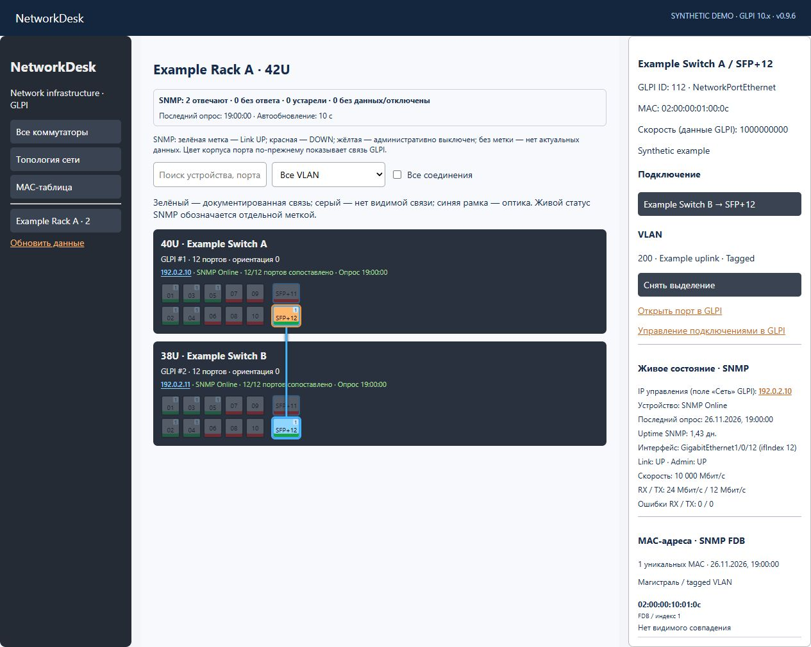
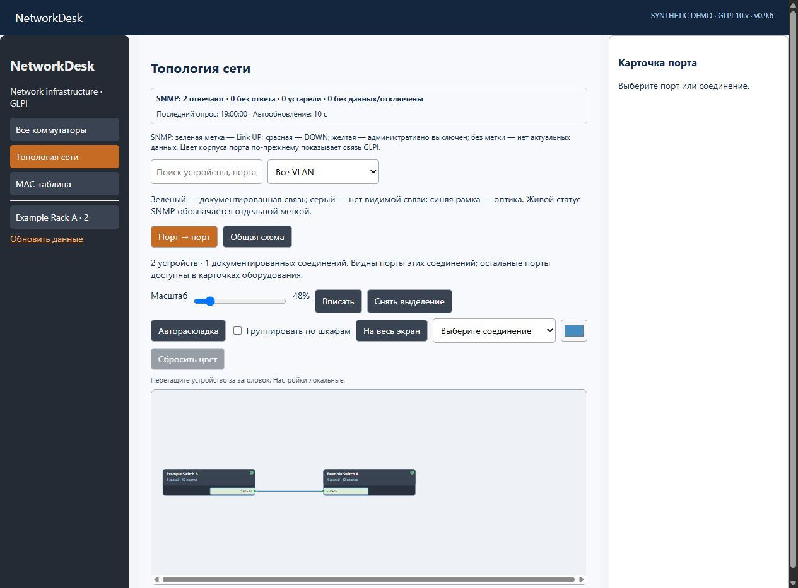

# NetworkDesk

Network infrastructure visualization and read-only SNMP monitoring for **GLPI 10.x**.

**Version 0.9.6 · Author and maintainer: hxmbrd · Private publication draft**

Explore racks, follow documented port connections and inspect live link states and learned MAC addresses from one GLPI view. GLPI remains the source of documented connections; SNMP adds observations without changing inventory or switch configuration.

## Features

- **Racks and switches:** rack placement, physical port panels, VLAN filters, search and links to native GLPI cards.
- **Topology:** port-to-port and overview maps, dragging, rack grouping, zoom, fullscreen and connection colors. Layout and color preferences stay in the current browser's local storage, scoped by installation path and GLPI user ID.
- **Live SNMP:** scheduled polling every **30 seconds**, with link/admin state, speed, uptime, errors and traffic rates where supported. The browser reads cached status every 10 seconds.
- **MAC discovery:** separate FDB polling every **60 seconds**, port counts, a searchable MAC table and matches against visible GLPI inventory. The browser reads this cache every 15 seconds.
- **Read-only integration:** GLPI session and object access checks; no SQL migrations or inventory writes. Pollers write only their local cache and lock files.

The interface currently uses Russian labels. This is an independent plugin, not an official GLPI project.

## Screenshots

These screenshots use the shipped frontend with entirely synthetic inventory and simulated polling responses. They demonstrate the UI, not a live GLPI deployment. Device labels, IPs and MACs are fictional.





## Requirements

- GLPI 10.x; existing metadata accepts 10.0.0–10.0.99. GLPI 11 is not supported.
- A PHP version supported by your exact GLPI release. Plugin syntax requires PHP 7.4 or later; this package was checked with PHP 8.3. See [validation](docs/VALIDATION.md) for the actual test scope.
- For polling: Linux, PHP CLI with the SNMP extension, and read-only device credentials. systemd is required for the supplied timers.
- A modern browser with SVG, Fetch, local storage, optional chaining and `Object.hasOwn` support.
- GLPI networking read permission and appropriate object/entity permissions.

No Composer or npm installation is required. GLPI, PHP and Net-SNMP are external dependencies and are not bundled.

## Installation

1. Back up the existing plugin and GLPI database. Keep backups outside `plugins/`, `marketplace/` and the web root.
2. Extract the release ZIP's `networkdesk/` directory into `GLPI/plugins/`. For a repository checkout, copy the repository contents into that directory; GitHub-generated source archives have a different outer directory name.
3. In GLPI, install/enable NetworkDesk under **Setup → Plugins**. Open **Assets → NetworkDesk** and refresh the browser cache.
4. Verify racks, ports, links and restricted-profile visibility in a test installation before deploying.

Examples assume GLPI at `/var/www/html/glpi`, PHP CLI at `/usr/bin/php` and web/PHP processes running as `www-data`. Adjust these to your installation. Pollers and the web process need the same cache-owning user because cache files are mode `0600`.

## SNMP configuration

Install the SNMP extension for the PHP CLI version you actually use, then verify it:

```bash
php -v
php -m | grep -i snmp
```

For a new installation, create private configuration and cache directories:

```bash
sudo install -d -m 0750 -o root -g www-data /etc/networkdesk
sudo install -d -m 0750 -o www-data -g www-data /var/lib/networkdesk
sudo test -e /etc/networkdesk/snmp.php || sudo install -m 0640 -o root -g www-data /var/www/html/glpi/plugins/networkdesk/config/snmp.example.php /etc/networkdesk/snmp.php
sudoedit /etc/networkdesk/snmp.php
```

**Never overwrite an existing `/etc/networkdesk/snmp.php` during an upgrade.** The example intentionally has an empty network allowlist, disabled polling and no credentials.

Set `allowed_networks` to explicitly approved management CIDRs, supply existing read-only credentials, and set `default.enabled` to `true` (or enable individual devices). `192.0.2.0/24` in examples is a documentation range, not a usable default for your network. Exclude passive equipment using your own GLPI IDs. Optional `port_map` entries map GLPI port IDs to verified SNMP ifIndex values.

Management IPv4 is read **only** from NetworkEquipment's **Network / «Сеть»** dropdown: `networkequipments.networks_id → networks.name`. The value must contain one valid IPv4 address and pass the allowlist. Port IPs, DNS names, subnets and arbitrary labels are not used. If `preferred_ip` is supplied, it must match that GLPI address. GLPI SNMP credentials are not imported automatically.

SNMPv1/v2c and SNMPv3 parameters are supported by the code. Prefer SNMPv3 `authPriv` where supported, and restrict UDP/161 to the poller. Actual SNMPv3 compatibility must be tested on your devices. Never commit credentials or copy the live configuration into the plugin directory.

Test one device (replace example ID `1` with your own), in this order:

```bash
sudo -u www-data /usr/bin/timeout 60s /usr/bin/php /var/www/html/glpi/plugins/networkdesk/bin/poll-snmp.php 1
sudo -u www-data /usr/bin/timeout 60s /usr/bin/php /var/www/html/glpi/plugins/networkdesk/bin/poll-mac.php 1
```

MAC discovery needs a recent successful IF-MIB poll and unambiguous port mapping. Omit the ID to poll all eligible devices. Polling is sequential; use an appropriate timeout for the inventory size.

## Automatic polling with systemd

Review the four files in `systemd/`, especially `User`, `Group`, `WorkingDirectory`, `ExecStart`, the database dependency and the 180-second timeout. If migrating from cron, back up the crontab and remove only the old NetworkDesk entries to avoid duplicate schedulers.

```bash
sudo cp /var/www/html/glpi/plugins/networkdesk/systemd/networkdesk-* /etc/systemd/system/
sudo systemctl daemon-reload
sudo systemctl start networkdesk-snmp.service
sudo systemctl start networkdesk-mac.service
sudo systemctl enable --now networkdesk-snmp.timer networkdesk-mac.timer
sudo systemctl list-timers --all 'networkdesk-*'
sudo journalctl -u networkdesk-snmp.service -u networkdesk-mac.service -n 50 --no-pager
```

| Process | Schedule | Browser refresh | Cache considered stale |
| --- | --- | --- | --- |
| SNMP / IF-MIB | Every minute at seconds 00 and 30 | 10 seconds | 240 seconds |
| MAC / FDB | Every minute at second 15 | 15 seconds | 300 seconds |

Each poller uses its own lock. systemd does not start a second instance of an active oneshot service; long polls can skip scheduled starts. These schedules do not guarantee fresh results from every device at each interval. A browser refresh reads cache and never initiates an SNMP query.

## Interpreting results and limitations

- `online` means the SNMP agent responded; `no_response` does not prove the device is powered off. `not_configured`, `disabled`, `pending`, `unavailable` and `stale` have distinct diagnostic messages.
- Documented connections and VLAN assignments do not imply an active link. Unknown or ambiguous port mappings remain unknown; `logical_number` is not assumed to equal ifIndex.
- Model names participate in existing layout and mapping heuristics. Vendor/model compatibility patterns are retained; they are not real inventory hostnames.
- MAC discovery handles BRIDGE-MIB and Q-BRIDGE-MIB, including an extra index found on some devices. The FDB index is not necessarily a VLAN ID. OID order checks remain enabled.
- A learned MAC can be downstream of another switch. Port roles are heuristics, not proof of direct attachment. Matches are limited to inventory visible to the logged-in GLPI user.
- The MAC table displays at most 1,000 filtered rows. Traffic rates need compatible counters and two suitable samples; SNMPv1 has no rate calculation here.
- No IPv6 management targets, ARP/IP discovery, LLDP discovery, MAC movement history, CPU/temperature/PoE monitoring, historical graphs or automatic cable creation.
- Equipment management links currently use HTTP. Use HTTPS manually where required. Browser layout settings are not synchronized between computers.
- Large-inventory performance, live GLPI permissions, actual devices and systemd execution require deployment testing. This draft is not certified for production.

## Development checks

Run from the repository root:

```bash
find . -name '*.php' -print0 | xargs -0 -n1 php -l
for file in js/*.js; do node --check "$file"; done
php tests/mapping.php
php tests/mac.php tests/fixtures/fdb-synthetic.txt
```

Test addresses and FDB entries are synthetic. See [CONTRIBUTING](CONTRIBUTING.md), [security guidance](SECURITY.md), [changelog](CHANGELOG.md) and [validation scope](docs/VALIDATION.md).

## Upgrade and rollback

Keep `/etc/networkdesk/snmp.php` and `/var/lib/networkdesk` separate from the plugin. Back up the plugin, replace its contents and refresh the browser cache. No database migration is introduced. When rolling back to a version without MAC discovery, disable and stop its timer and service first:

```bash
sudo systemctl disable --now networkdesk-mac.timer
sudo systemctl stop networkdesk-mac.service
```

To disable all polling, repeat for `networkdesk-snmp`. Restore the backed-up plugin and prior scheduler if needed, without duplicate jobs. Uninstalling the plugin does not remove external configuration, cache or timers.

## Authors and licensing

**hxmbrd** is the author/maintainer listed in the release metadata. The source archive declares `GPLv3`; that declaration is retained unchanged. It does not include a license text or enough provenance to settle the exact grant and attribution obligations. No new license has been selected. Keep this repository private until those questions are resolved. See [LICENSE-STATUS](LICENSE-STATUS.md) and [DEPENDENCIES](DEPENDENCIES.md).
